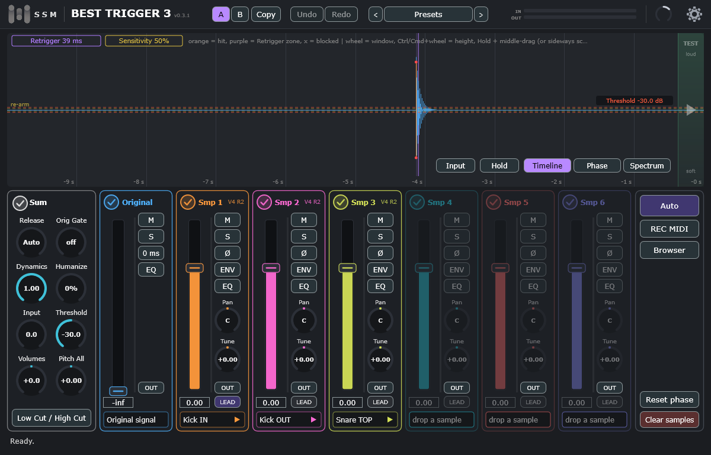

# Best Trigger 3

[English](#english) · [Русский](#русский)

## English

**Drum trigger plugin (VST3) with an oscilloscope.** It finds the hits on a recorded drum track and plays your samples on them.

- **Full Auto** sets the threshold, the phase of the samples and their balance for you.
- Up to six samples per hit, with automatic phase alignment.
- Scope with **Timeline**, **Phase** and **Spectrum** views.
- Separate outputs, sample browser, online libraries, (free .tci) to .bt3 converter.

**Manual:** [English](https://ssm-audio.github.io/Best-Trigger-3/manual-en.html) · **Changelog:** [CHANGELOG.md](CHANGELOG.md#english) · [Video](https://www.youtube.com/@SSM-AUDIO) · [Telegram](https://t.me/ssm_metalmix)

> Proprietary software. © 2026 SSM-Audio. All rights reserved. This page only carries the installers (see [Releases](../../releases)).

**Try it for 14 days, all functions open, no key needed.** Then buy a licence key: [how to buy](https://ssm-audio.github.io/Best-Trigger-3/download.html).

1. Download the installer for your system from **[Releases](../../releases/latest)**.
2. Run it. If Windows shows a blue warning: **More info → Run anyway**. On macOS: right-click the `.pkg` → **Open** ([details](docs/INSTALL-macOS.md#english)).
3. Rescan plugins in your DAW, insert the plugin on a drum track and press **Start 14-day trial** (or enter your key). Internet is needed once.

Windows 10/11 64-bit or macOS 10.15+; a DAW with VST3.

## Русский

**Плагин-триггер для барабанов (VST3) с осциллографом.** Находит удары на записанной дорожке и играет на них ваши сэмплы.

- **Full Auto** сам подбирает порог, фазу сэмплов и их баланс.
- До шести сэмплов на один удар с автоматическим выравниванием фазы.
- Осциллограф с видами **Timeline**, **Phase** и **Spectrum**.
- Отдельные выходы, браузер сэмплов, онлайн-библиотеки, конвертер не коммерческих .tci в .bt3.

**Руководство:** [Русский](https://ssm-audio.github.io/Best-Trigger-3/manual-ru.html) · **История изменений:** [CHANGELOG.md](CHANGELOG.md#русский) · [Видео](https://www.youtube.com/@SSM-AUDIO) · [Telegram](https://t.me/ssm_metalmix)

> Программа с закрытым исходным кодом. © 2026 SSM-Audio. Все права защищены. На этой странице только установщики (см. [Releases](../../releases)).

**Попробуйте 14 дней: все функции открыты, ключ не нужен.** Потом купите лицензионный ключ: [как купить](https://ssm-audio.github.io/Best-Trigger-3/download.html).

1. Скачайте установщик для вашей системы на странице **[Releases](../../releases/latest)**.
2. Запустите его. Если Windows показывает синее предупреждение: **Подробнее → Выполнить в любом случае**. На macOS: правый щелчок по `.pkg` → **Открыть** ([подробнее](docs/INSTALL-macOS.md#русский)).
3. Пересканируйте плагины в DAW, вставьте плагин на дорожку барабана и нажмите **Start 14-day trial** (или введите ключ). Один раз нужен интернет.

Windows 10/11 (64 бита) или macOS 10.15+; DAW с поддержкой VST3.

---

© 2026 SSM-Audio. VST is a trademark of Steinberg Media Technologies GmbH. [THIRD_PARTY_NOTICES.md](THIRD_PARTY_NOTICES.md)
